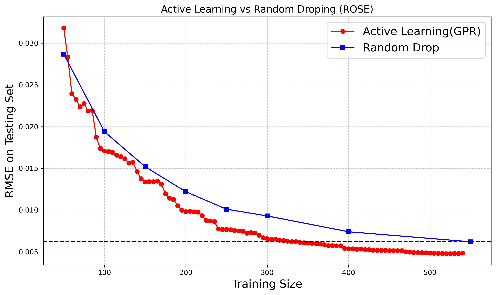
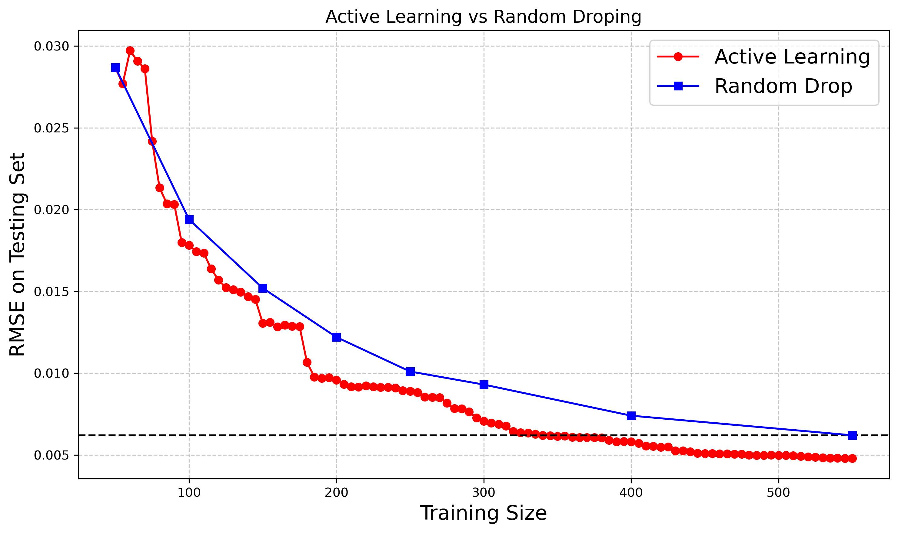

# surrogate_AL — Active Learning for Uncertainty-Aware ML Surrogates of Molecular Dynamics

Active-learning framework for training machine-learning surrogates of molecular dynamics (MD) simulations, applied to **ions confined between nanoparticle surfaces** (data from [nanoconfinement-md](https://github.com/softmaterialslab/nanoconfinement-md)). The surrogate predicts ionic density profiles from system parameters (confinement length, ion valencies and sizes, salt concentration, surface charge density) and reports its own uncertainty, which drives which simulations to add next.

Workflows run on HPC through [ROSE](https://github.com/radical-cybertools) (Radical Orchestrator for Surrogate Exploration) on top of RADICAL-AsyncFlow / RADICAL-Pilot.

## How it works
1. **Bootstrap** – draw an initial training set from the pool of MD results
2. **Train** – fit an uncertainty-aware surrogate
3. **Acquire** – score the remaining pool by predictive uncertainty and add the most uncertain samples
4. Repeat for a set number of iterations; compare against random sampling

### Surrogate models (`rose/code/config/`)
| Config | Model |
|---|---|
| `gpr.yaml` | Gaussian process regression (GPy / GPyTorch) |
| `bnn.yaml` | Bayesian neural network (PyTorch, Monte Carlo sampling) |
| `mcd.yaml` | Monte Carlo dropout network (PyTorch) |

## Repository layout
```
rose/
  code/
    bootstrap.py               # initial training set
    train.py                   # train a surrogate for one iteration
    active.py                  # uncertainty-based sample selection
    run_rose.py                # sequential AL pipelines on HPC via ROSE
    run_rose_with_conccurent.py# concurrent pipelines
    use_case.py                # parallel learners with best-model selection
    model/models.py            # BNN, MC dropout, GPR + early stopping
    utils.py                   # preprocessing and metrics (RMSE, R², Spearman)
    config/                    # model configs
    data/                      # preprocessed density data and scalers
  result/fig/                  # GPR active-learning results
non_rose/
  peak_density_demo.ipynb      # standalone notebook, no workflow system
  model/ data/
```

## Quick start
**Standalone (no HPC):** open `non_rose/peak_density_demo.ipynb`.

**With ROSE:**
```bash
pip install torch gpytorch GPy scikit-learn scipy pyyaml joblib
# plus ROSE and radical.asyncflow / radical.pilot
cd rose/code
python run_rose.py      # edit resource, project and data paths at the top first
```
`run_rose.py` is set up for NCSA Delta (`ncsa.delta_gpu_a40`); change the resource, allocation and `input_data_dir` for your machine.

## Results
| Active learning (ROSE) | Active learning (standalone) |
|---|---|
|  |  |

## Related work
- F. Sun, JCS Kadupitiya, V. Jadhao, *Probing accuracy-speedup tradeoff in machine learning surrogates for molecular dynamics simulations*, J. Chem. Theory Comput. 19, 4606 (2023)
- A. Alsaadi et al., *ROSE: Radical Orchestrator for Surrogate Exploration*, AI4S Workshop @ SC'25 (2025)
- F. Sun, V. Jadhao, *Designing uncertainty-aware machine learning surrogates for molecular dynamics simulations using active learning* (in preparation)

## Contact
Fanbo Sun — Indiana University Bloomington · fanbsun@iu.edu
